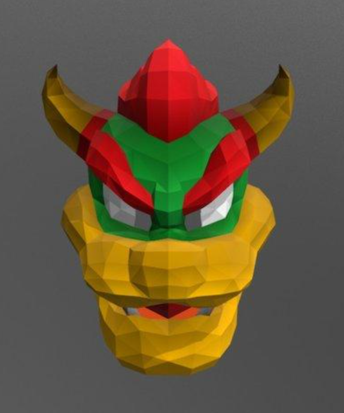

# Cricut PDF to SVG

A local tool for converting papercraft PDF pages into Cricut-oriented SVG paths. It detects every piece, its mountain and valley folds and its edge numbers, and writes the whole template as one Inkscape file for review. Sheet nesting is future work.

## Convert the Bowser template

The source PDF is kept locally at `data/bowser.pdf` and is ignored by Git. The manifest at `data/bowser.yaml` maps its pages to cardstock materials. Install Python 3.10 or newer, Poppler (`pdftoppm`) and Tesseract OCR (`tesseract`), then from the repository root run:

```sh
make install
make                 # all pages -> output/bowser/bowser.svg
make page PAGE=4     # one page -> output/bowser/page-4/bowser.svg
```

Without `make`, run the same steps directly:

```sh
python -m pip install -r requirements.txt
python -m src.lowpoly_pdf_to_svg --config data/bowser.yaml
python -m src.lowpoly_pdf_to_svg --config data/bowser.yaml --page 4 --output output/bowser/page-4
```

If Poppler is not on `PATH`, add `--pdftoppm C:\path\to\pdftoppm.exe`.

## Pipeline

Each stage is a class in `src/lowpoly_pdf_to_svg/`:

| Stage | Module | What it does |
| --- | --- | --- |
| Manifest | `config.py` | Reads the YAML: source PDF, sheet size, pages per cardstock. |
| Render | `render.py` | Renders each page with `pdftoppm` at 180 dpi; the PNG is kept in `output/<project>/previews/`. |
| Detect | `detect.py` | Separates grey cut lines, dashed folds and black edge numbers. The paper around the pieces is flood-filled from the page border; each enclosed area grows through everything the fill did not reach, so numbers and fold dashes touching a cut line cannot notch it. Outlines are low-poly: every edge is a straight line fitted to the printed cut line, corners are where edges meet. The right margin's "Print on … paper" note is read and checked against the YAML. Folds are found with a Hough transform, classified as mountain (dash-dot) or valley (dashed), and stretched into one straight line from cut edge to cut edge; a line that is not mostly printed dashes is dropped. |
| Read numbers | `ocr.py` | Tesseract reads each number; its confident reads train a digit matcher on the template's own font, which reads every number again. Every edge number is printed exactly twice, so uncertain reads prefer the candidate that completes a pair. |
| Edge pairs | `edges.py` | Links each number to the line it marks (a plain cut edge, or the fold of a glue tab) and pairs the two copies. Writes `<project>-edges.csv` and the summary `<project>-report.md`: a good pair is one tab and one plain edge of the same length. |
| Model | `model.py` | `Piece`, `Fold`, `Label` and `PageLayout`, in page pixels. |
| Write | `svg.py` | One Inkscape SVG for the whole project, in millimetres. |

## Reviewing in Inkscape

`bowser.svg` needs Inkscape 1.2 or newer. Every PDF page is an Inkscape page laid out left to right at its true size (US Letter for this source). The layers are:

- **Source**: the rendered scans, locked and faint, to compare traces against.
- **Pieces**, with one sublayer per cardstock: each piece is one group named like `piece-04-03`, holding its `Cut` outline, `Score` folds (`Mountain folds` dash-dot blue, `Valley folds` dashed green) and `Draw` edge numbers as rotated text. The group carries `data-material` for later nesting.
- **Review** (hidden): artwork outside every piece, such as credits, instructions or an outline the detector could not close. Move anything that belongs to a piece into it.

Numbers the reader is unsure of are orange (`data-review="ocr"`), and their piece is labelled `⚠ check numbers`. On the Bowser template about 56% of numbers are read with confidence, and a spot check put those at roughly 90% correct; the orange ones are wrong more often. Folds that had to be stretched far to reach the cut have `data-review="unsnapped"` and the piece is labelled `⚠ check folds`. Search for either with Edit > Find.

The numbers are text, so you can correct one by double-clicking it. For the Cricut pen, turn them into single-stroke paths with Extensions > Text > Hershey Text before export. Before uploading to Design Space, delete the Source and Review layers, then assign Score to the fold paths and Draw/Pen to the number paths and attach them to each cut outline.

## Intended workflow

- Convert PDF pages into usable vector paths, including paths traced from raster artwork where needed.
- Keep each paper piece as a movable item group with a cardstock color attribute.
- Separate operations inside each group: solid cut paths, dashed score paths for folds, and pen-drawn number labels that match assembly edges.
- Nest whole item groups by cardstock color onto configured sheets, initially 12 × 12 inch or A4, while reducing waste and preventing overlap.
- Export SVGs organized by material and sheet for review and Cricut Design Space.

Cricut Design Space imports SVG vectors as Cut by default. After import, assign the fold layer to Score and the number layer to Draw/Pen, then attach them to the matching cut pieces. See [Cricut's SVG upload guide](https://help.cricut.com/hc/en-us/articles/360009556313-How-to-upload-images-into-Design-Space) and [operation guide](https://help.cricut.com/hc/en-us/articles/26922998476183-Design-Space-Selecting-Operation).

See PLAN.md for the remaining development stages.

## Bowser papercraft credit

The Bowser papercraft mask was created by Sweets The Cat (also credited as Papercraft Cat) as a Halloween project. The creator's Sketchfab model page says the free template was available through the creator's itch.io papercraft shop. Sketchfab is the model reference; itch.io is the creator's stated distribution source. Paperzone VN hosts a community repost with a ZIP attachment and is a mirror, not the original creator source.

- Creator shop: [Sweets The Cat on itch.io](https://sweetsthecat.itch.io/)
- Interactive 3D model: [Papercraft Bowser Mask by Sweets The Cat on Sketchfab](https://sketchfab.com/3d-models/papercraft-bowser-mask-92627b8a93c941b89dad9f6ab62a8fe9)
- Community mirror/download thread: [Paperzone VN](https://paperzonevn.com/bowser-mask.t13095/)

GitHub's README renderer does not display the interactive Sketchfab iframe, so the model is linked above. An embedded viewer would need a separate HTML page hosted with GitHub Pages.

The creator described the template as free for personal use. This repository does not include or redistribute the PDF. Check the creator's current terms before using or sharing derived files.

## Bowser papercraft example


